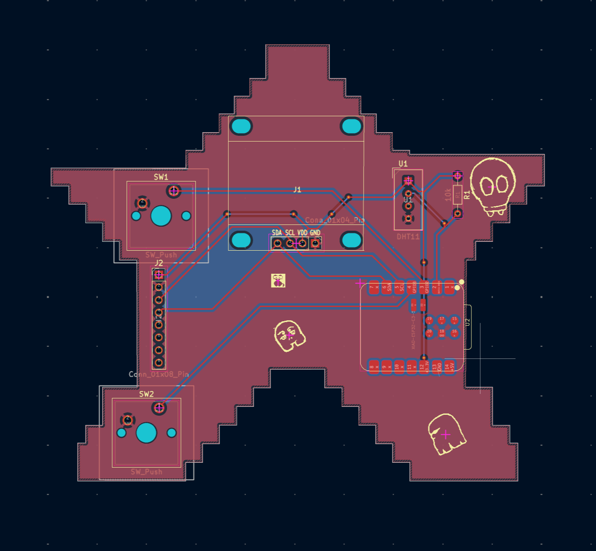

# Hack Club

## Week 1: Starbie

Starbie is a PCB-based starter project built as part of Hack Club.
The project's end goal is a companion device.
It is motion-controlled digital pet.

The folder `./Starbie/` contains the schematics and the PCB layouts for Starbie.

The folder `./Sketch/Starbie` contains the code required for running the digital pet on the ESP32-C3

### Schematic View:

### PCB Layout

### Highlights

1. **ESP32-C3 Microcontroller:** Main controller managing logic, animation, and peripheral interfaces.

2. **OLED Display Module:** Screen providing the visual user interface for the pet.

3. **Motion Sensing:** Motion-controlled interaction allowing physical movement to influence the pet state.

## BOM
| Part | What it's for | Qty | Unit | Total | Vendor |
| --- | --- | --- | --- | --- | --- |
| [Conn_01x04_Pin](https://www.giganepal.com/product/male-header-pin-40-pin-header-strip-2-54-mm-for-arduino-connector/) | 4-pin header connector for plugging in the OLED display module to render Starbie's face | 1 | $0.26 | $0.26 | [Giga Ventures](https://www.giganepal.com/product/male-header-pin-40-pin-header-strip-2-54-mm-for-arduino-connector/) |
| [Conn_01x08_Pin](https://www.giganepal.com/product/male-header-pin-40-pin-header-strip-2-54-mm-for-arduino-connector/) | 8-pin header strip connector for connecting the MPU6050 accelerometer/gyroscope module for motion-controlled pet interaction | 1 | $0.26 | $0.26 | [Giga Ventures](https://www.giganepal.com/product/male-header-pin-40-pin-header-strip-2-54-mm-for-arduino-connector/) |
| [10k](https://www.daraz.com.np/products/1k-ohm-resistor-10-pack-1000-ohm-resistors-for-electronics-diy-projects-i128939919-s1036885458.html?channelLpJumpArgs&freeshipping=0&fs_ab=1&fuse_fs&lang=en&location=Bagmati%20Province&price=29&priceCompare=skuId%3A1036885458%3Bsource%3Alazada-search-voucher%3Bsn%3A13c8745be32432d3cc4ee97215f8a9e8%3BoriginPrice%3A2900%3BdisplayPrice%3A2900%3BisGray%3Afalse%3BsinglePromotionId%3A50000058713011%3BsingleToolCode%3ApromPrice%3BvoucherPricePlugin%3A0%3Btimestamp%3A1791664864621&ratingscore=4.866666666666666&request_id=13c8745be32432d3cc4ee97215f8a9e8&review=15&sale=207&source=search&stock=1) | Resistor connected to DHT11 sensor | 1 | $0.25 | $0.25 | [Daraz](https://www.daraz.com.np/products/1k-ohm-resistor-10-pack-1000-ohm-resistors-for-electronics-diy-projects-i128939919-s1036885458.html?channelLpJumpArgs&freeshipping=0&fs_ab=1&fuse_fs&lang=en&location=Bagmati%20Province&price=29&priceCompare=skuId%3A1036885458%3Bsource%3Alazada-search-voucher%3Bsn%3A13c8745be32432d3cc4ee97215f8a9e8%3BoriginPrice%3A2900%3BdisplayPrice%3A2900%3BisGray%3Afalse%3BsinglePromotionId%3A50000058713011%3BsingleToolCode%3ApromPrice%3BvoucherPricePlugin%3A0%3Btimestamp%3A1791664864621&ratingscore=4.866666666666666&request_id=13c8745be32432d3cc4ee97215f8a9e8&review=15&sale=207&source=search&stock=1) |
| [SW_Push](https://www.giganepal.com/product/push-button-switch/) | Interactive push buttons connected to GPIO2 and GPIO3 | 2 | $0.07 | $0.14 | [Giga Ventures](https://www.giganepal.com/product/push-button-switch/) |
| [DHT11](https://www.giganepal.com/product/temperature-humidity-sensor-dht-11/) | WHAT IT'S FOR: Environment sensor allowing Starbie to react dynamically to surrounding room temperature and humidity | 1 | $2.20 | $2.20 | [Giga Ventures](https://www.giganepal.com/product/temperature-humidity-sensor-dht-11/) |
| [XIAO-ESP32-C3-SMD](https://www.daraz.com.np/products/10pcs1pc-seeeduino-seeed-studio-xiao-esp32-c3-esp32c3-esp32c6-wifi-wireless-bluetooth-development-board-mcu-4mb-for-arduino-i334090326-s1484070689.html?) | Brain of the whole system which controls full Starbie. Handles sensor's inputs, pet state logic and animations | 1 | $10.50 | $10.50 | [Daraz](https://www.daraz.com.np/products/10pcs1pc-seeeduino-seeed-studio-xiao-esp32-c3-esp32c3-esp32c6-wifi-wireless-bluetooth-development-board-mcu-4mb-for-arduino-i334090326-s1484070689.html?) |
| [0.96_OLED_I2C](https://www.giganepal.com/product/0-96-inch-oled-display) | To render Starbie's face expressions, and animations | 1 | $4.40 | $4.40 | [Giga Ventures](https://www.giganepal.com/product/0-96-inch-oled-display) |
| **Parts subtotal** | — | — | — | **$18.01** | — |
| **Tax & shipping** | — | — | — | **$9.00** | — |
| **Total** | — | — | — | **$27.01** | — |

$2.99 left of the tier's funding.
